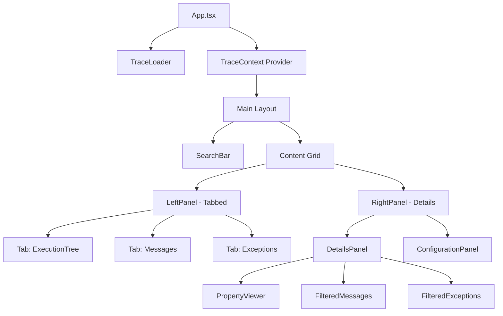
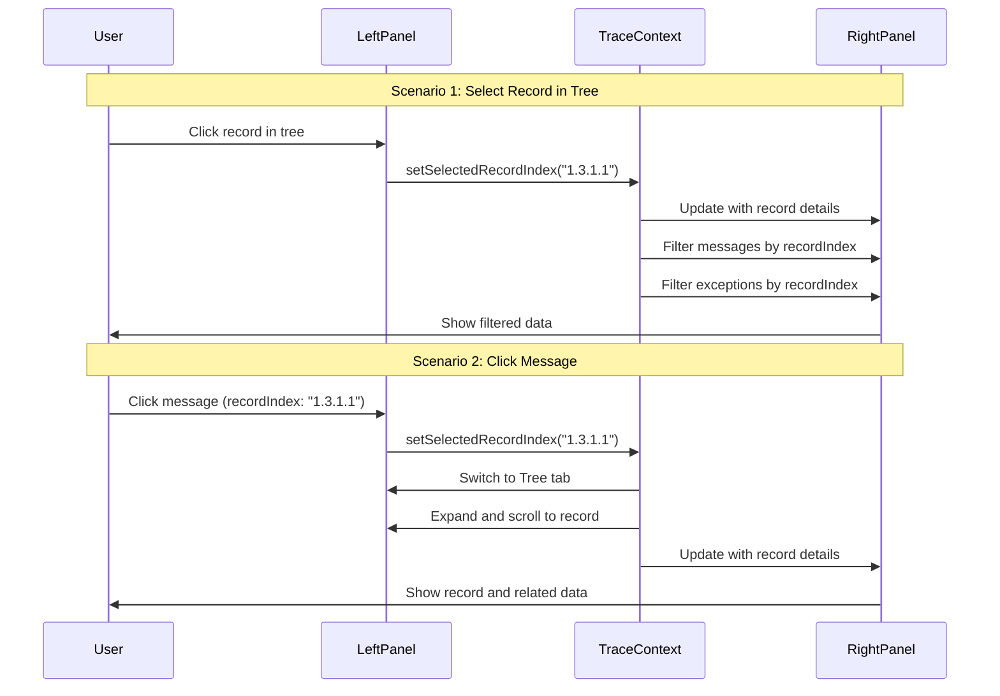

# Decision Execution Trace Explorer - Architecture Documentation

## Overview
A React-based single-page application for visualizing execution traces from decision models and ruleflows, featuring bidirectional navigation between execution records, messages, and exceptions.

## Updated Architecture with Bidirectional Navigation

### Key Interaction Model

The application supports **bidirectional navigation** using `recordIndex` as the linking key:

1. **Select a record in tree** → Filter messages/exceptions to show only those with matching recordIndex
2. **Click a message** → Navigate to and highlight the corresponding record in tree
3. **Click an exception** → Navigate to and highlight the corresponding record in tree

### Component Architecture



### Updated Layout Design

```
┌─────────────────────────────────────────────────────────────┐
│ Header: Trace Explorer + TraceLoader                          │
├─────────────────────────────────────────────────────────────┤
│ SearchBar + Controls                                         │
├──────────────────────────┬──────────────────────────────────┤
│                          │                                  │
│  LEFT PANEL (Tabbed)     │     RIGHT PANEL (Details)        │
│  (40% width)             │     (60% width)                  │
│                          │                                  │
│  ┌────────────────────┐  │  ┌────────────────────────────┐  │
│  │ [Tree][Msgs][Excp] │  │  │ Selected Record Details    │  │
│  ├────────────────────┤  │  ├────────────────────────────┤  │
│  │                    │  │  │ • Record Index: 1.3.1.1    │  │
│  │ ACTIVE TAB VIEW:   │  │  │ • Type: Rule               │  │
│  │                    │  │  │ • Name: checkAge           │  │
│  │ Tree View:         │  │  ├────────────────────────────┤  │
│  │  └─ DecisionModel  │  │  │ Tabs: [Overview][Input]    │  │
│  │     ├─ InputData   │  │  │       [Output][Properties] │  │
│  │     ├─ Decision    │  │  │                            │  │
│  │     │  └─ Rule ✓   │  │  │ {JSON data display}        │  │
│  │     └─ ...         │  │  │                            │  │
│  │                    │  │  ├────────────────────────────┤  │
│  │ OR Messages View:  │  │  │ Related Messages (2)       │  │
│  │  • [1.3.1.1] OK... │  │  │  • [1.3.1.1] OK: note...   │  │
│  │  • [1.3] OK...     │  │  │  • [1.3] OK: note...       │  │
│  │                    │  │  ├────────────────────────────┤  │
│  │ OR Exceptions View:│  │  │ Related Exceptions (0)     │  │
│  │  (empty)           │  │  │  (none for this record)    │  │
│  │                    │  │  ├────────────────────────────┤  │
│  └────────────────────┘  │  │ Configuration              │  │
│                          │  │  (collapsible)             │  │
│                          │  └────────────────────────────┘  │
└──────────────────────────┴──────────────────────────────────┘
```

## Data Flow with Bidirectional Navigation



## Component Specifications

### 1. TraceContext (State Management)

**State:**
```typescript
interface TraceContextState {
  traceData: TraceData | null;
  selectedRecordIndex: string | null;
  activeLeftTab: 'tree' | 'messages' | 'exceptions';
  expandedNodes: Set<string>;
  searchQuery: string;
}
```

**Key Methods:**
- `setSelectedRecordIndex(index: string)` - Updates selection and triggers filtering
- `navigateToRecord(index: string)` - Switches to tree tab, expands path, scrolls to record
- `getFilteredMessages(recordIndex?: string)` - Returns messages for specific record or all
- `getFilteredExceptions(recordIndex?: string)` - Returns exceptions for specific record or all
- `findRecordByIndex(index: string)` - Locates record in nested structure

### 2. LeftPanel Component

**Features:**
- Carbon Tabs component with three tabs
- Tab 1: ExecutionTreeView
- Tab 2: MessagesListView  
- Tab 3: ExceptionsListView
- Badge counts on tabs (e.g., "Messages (5)")

### 3. ExecutionTreeView Component

**Features:**
- Hierarchical tree with Carbon TreeView
- Icons for record types (DecisionModel, Rule, Task, etc.)
- Highlight selected record
- Auto-expand path to selected record
- Auto-scroll to selected record
- Click handler: `onRecordSelect(recordIndex)`

### 4. MessagesListView Component

**Features:**
- List of all printed messages
- Each item shows: `[recordIndex] message text`
- Clickable items that call `navigateToRecord(recordIndex)`
- Highlight if message belongs to selected record
- Empty state when no messages

### 5. ExceptionsListView Component

**Features:**
- List of all raised exceptions
- Each item shows: `[recordIndex] exception details`
- Clickable items that call `navigateToRecord(recordIndex)`
- Highlight if exception belongs to selected record
- Empty state when no exceptions

### 6. RightPanel (DetailsPanel) Component

**Sections:**
1. **Record Overview** - Basic info about selected record
2. **Tabbed Details** - Input/Output/Properties with JSON viewers
3. **Related Messages** - Filtered list showing only messages with matching recordIndex
4. **Related Exceptions** - Filtered list showing only exceptions with matching recordIndex
5. **Configuration** - Collapsible accordion showing trace configuration

**Filtering Logic:**
```typescript
// Show only messages/exceptions where recordIndex matches selected record
const relatedMessages = messages.filter(msg => 
  msg.recordIndex === selectedRecordIndex
);
```

## Data Models

### TypeScript Interfaces

```typescript
interface TraceData {
  configuration: Configuration;
  rootRecord: Record;
  printedMessages: PrintedMessage[];
  exceptionsRaised: Exception[];
}

interface Record {
  recordType: string;
  recordIndex: string; // e.g., "1.3.1.1" - hierarchical identifier
  properties: RecordProperties;
}

interface RecordProperties {
  name?: string;
  kind?: string | string[];
  input?: Record<string, any>;
  output?: Record<string, any>;
  nestedRecords?: Record[];
  [key: string]: any;
}

interface PrintedMessage {
  recordIndex: string; // Links to Record.recordIndex
  message: string;
}

interface Exception {
  recordIndex: string; // Links to Record.recordIndex
  exceptionType?: string;
  message?: string;
  [key: string]: any;
}
```

## Navigation Utilities

### Record Index Parsing
```typescript
// Parse hierarchical index: "1.3.1.1" → ["1", "3", "1", "1"]
function parseRecordIndex(index: string): string[] {
  return index.split('.');
}

// Build path to record for tree expansion
function buildPathToRecord(index: string): string[] {
  const parts = parseRecordIndex(index);
  const paths: string[] = [];
  for (let i = 1; i <= parts.length; i++) {
    paths.push(parts.slice(0, i).join('.'));
  }
  return paths;
}
```

### Tree Navigation
```typescript
// Find record in nested structure
function findRecordByIndex(
  root: Record, 
  targetIndex: string
): Record | null {
  if (root.recordIndex === targetIndex) return root;
  
  if (root.properties.nestedRecords) {
    for (const nested of root.properties.nestedRecords) {
      const found = findRecordByIndex(nested, targetIndex);
      if (found) return found;
    }
  }
  
  return null;
}
```

## Performance Considerations

1. **Virtual Scrolling**: Use for tree with 1000+ nodes
2. **Memoization**: Memoize filtered messages/exceptions
3. **Lazy Expansion**: Load nested records on demand
4. **Debounced Search**: 300ms delay for search input
5. **Index Map**: Build recordIndex → Record map on load for O(1) lookup

## Accessibility

- Keyboard navigation in tree (Arrow keys, Enter, Space)
- Tab navigation between left/right panels
- ARIA labels for all interactive elements
- Focus management when navigating between views
- Screen reader announcements for selection changes

## Testing Scenarios

1. **Tree → Details**: Select record, verify filtered messages/exceptions
2. **Message → Tree**: Click message, verify tree navigation and expansion
3. **Exception → Tree**: Click exception, verify tree navigation
4. **Search**: Search for record name, verify filtering across all views
5. **Large Trace**: Test with bigtrace.json (40K lines) for performance
6. **Empty States**: Test with traces having no messages/exceptions

## Technology Stack

- **React 18+** with TypeScript
- **Vite** for build tooling
- **Carbon Design System v11** (@carbon/react)
- **@carbon/icons-react** for icons
- **react-json-view** or **@uiw/react-json-view** for JSON display
- **@tanstack/react-virtual** for virtual scrolling (if needed)